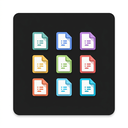

# ByteStackLab Theme Icons

File icon theme crafted for VS Code by ByteStackLab.

---

## Features

- 🎯 **Official Language & Tool Logos** — Authentic icons for JavaScript, TypeScript, Python, React, Vue, PHP, Go, Rust, Java, Docker, Git, and 100+ other technologies
- 📁 **Smart Folder Icons** — Custom folder icons for `src`, `components`, `dist`, `node_modules`, `tests`, `docs`, and 4,000+ directory patterns with open/closed states
- ⚡ **Complete Coverage** — Over 1,200+ icons covering 1,300+ file extensions and 2,000+ filenames
- 🎨 **Cohesive Aesthetic** — Designed to pair seamlessly with your favorite dark and light themes
- 🚀 **Ultra-lightweight** — Pure optimized SVGs with zero runtime overhead

## Installation

1. Install from VS Code Marketplace
2. Open Command Palette (`Cmd+Shift+P` / `Ctrl+Shift+P`) → `Preferences: File Icon Theme`
3. Select **ByteStackLab Theme Icons**

## License

MIT © [ByteStackLab](https://bytestacklab.com)
